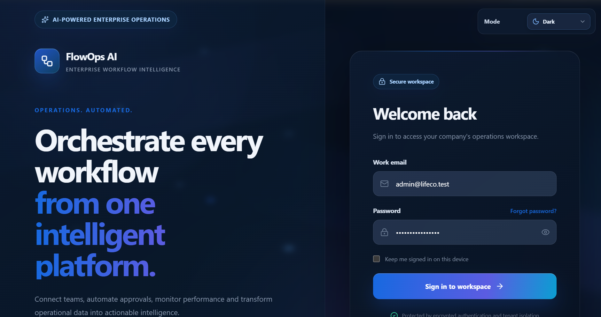
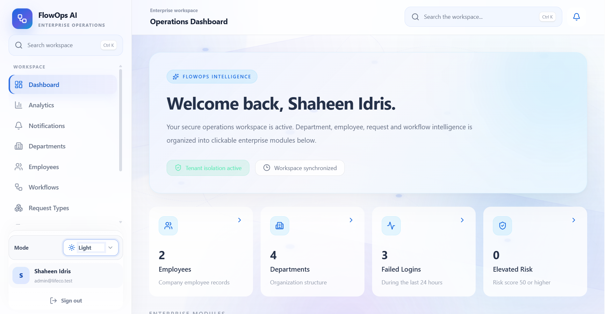
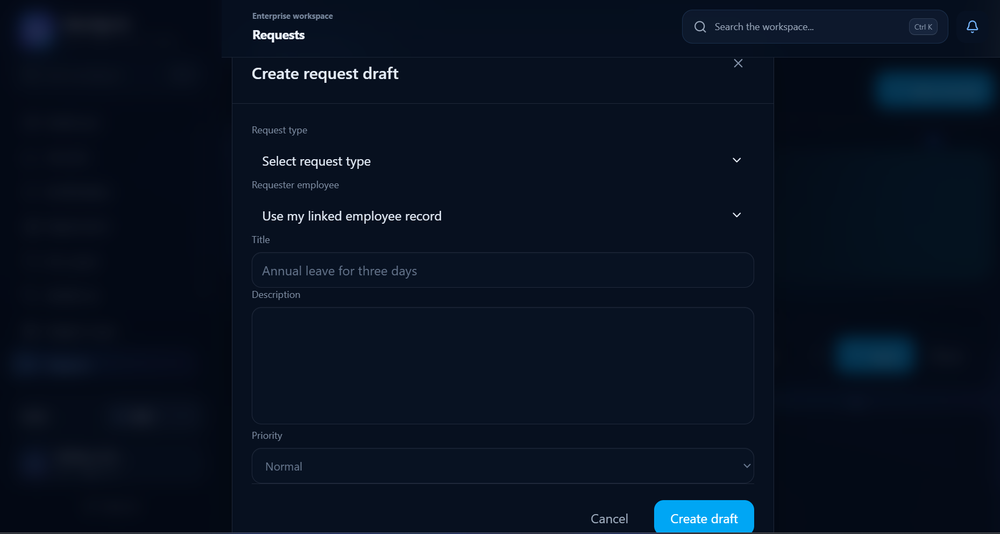
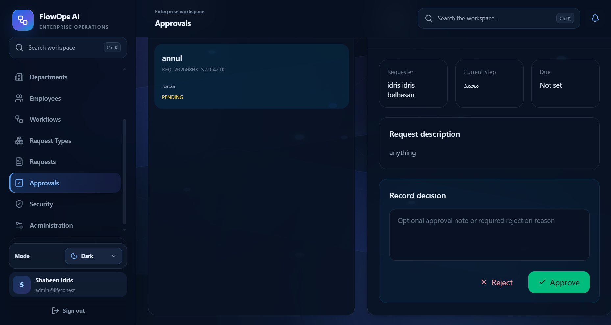
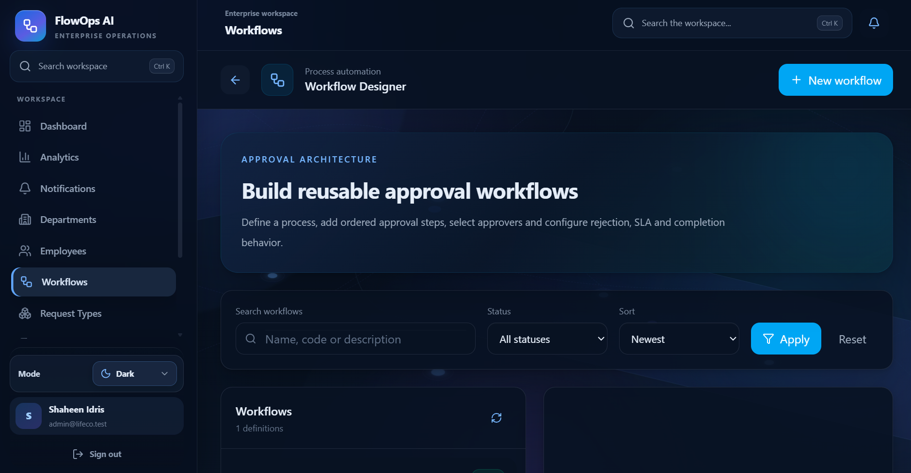
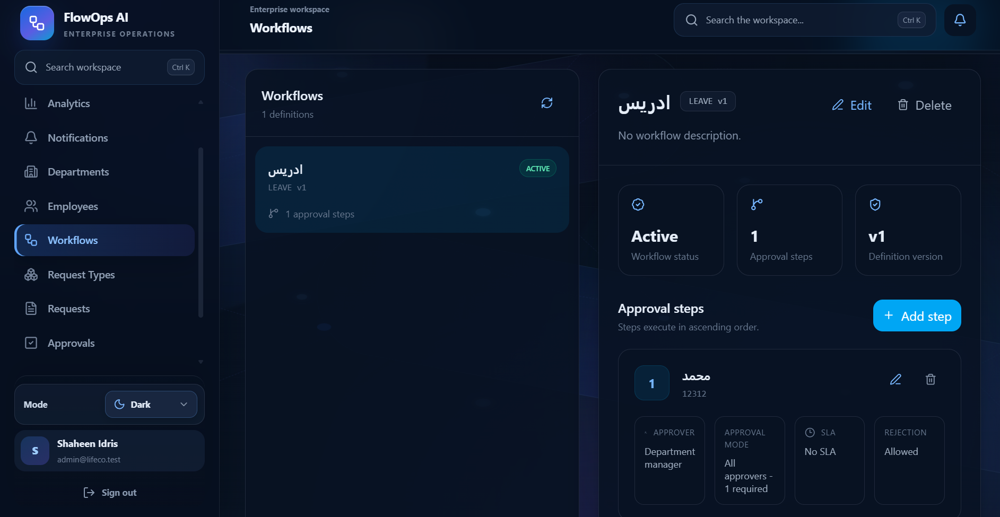
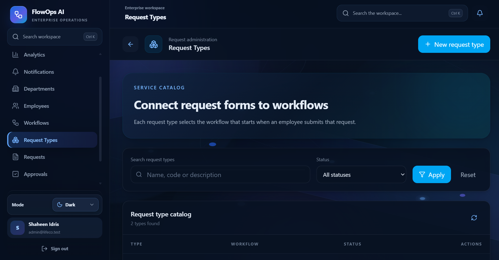
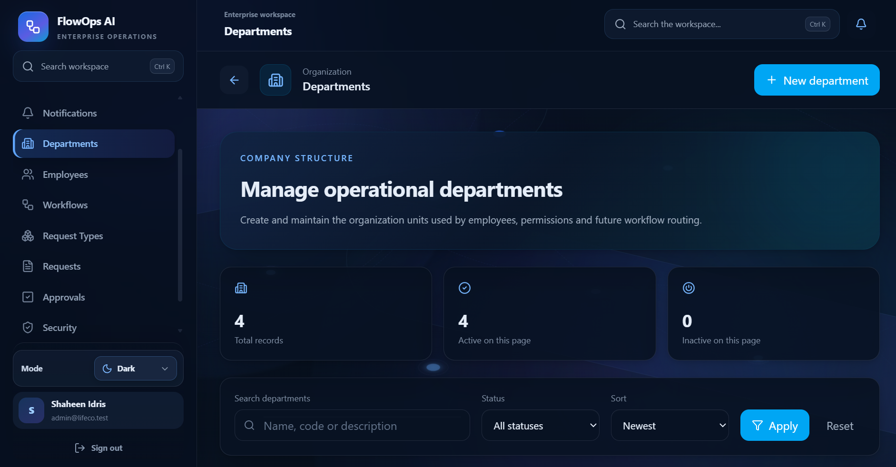
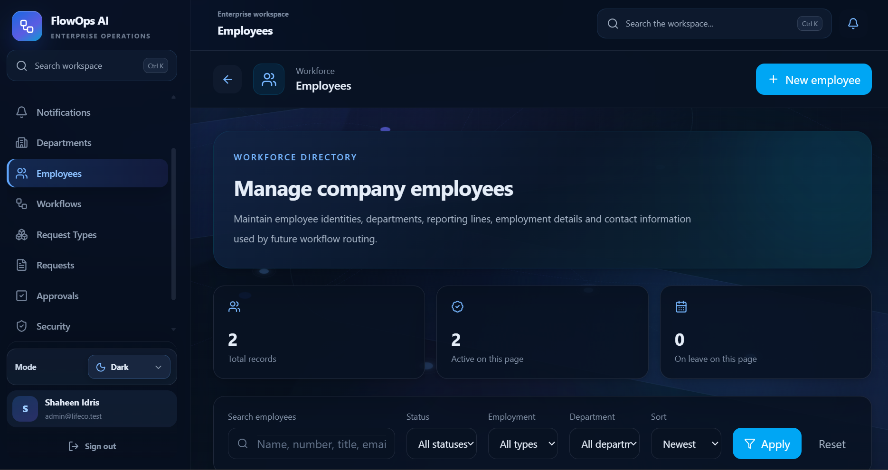
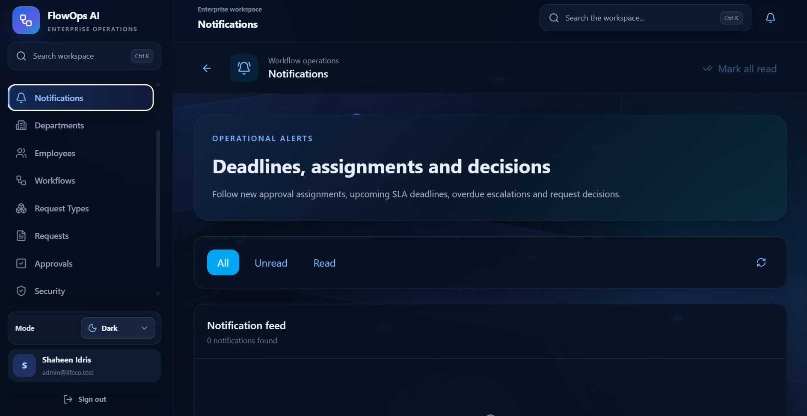

# FlowOps AI

**Enterprise Workflow / BPM / Operations Platform**

FlowOps AI is a full-stack enterprise workflow platform for managing internal company requests, approval workflows, notifications, analytics, security monitoring, role-based access control, and administration.

Built as a production-quality portfolio project using **Laravel, React, TypeScript, PostgreSQL, Redis, Docker, and enterprise permission design**.

---

## Problem

Many organizations still manage internal approvals through email, spreadsheets, chat messages, and manual follow-up.

This creates operational problems:

- Requests get lost or delayed.
- Approval ownership is unclear.
- Managers cannot easily see pending work.
- Security and permissions are difficult to control.
- Request history, failed logins, workflow status, and performance are hard to monitor.

---

## Solution

FlowOps AI centralizes internal operations into one structured enterprise workspace.

Employees can create requests, the system routes them through active workflows, approval tasks are generated automatically, approvers make decisions from their inbox, notifications keep users informed, and administrators get visibility into roles, permissions, security, and audit activity.

---

## Live Demo

A public demo account will be added after production hosting is configured.

```text
Status: Private repository / local Docker demo
Public demo URL: Coming soon
Demo email: demo@flowops.test
Demo password: Will be published only after deployment
```

The demo account will use limited permissions and fake data only.

---

## Preview

### Secure Login



### Operations Dashboard



### Create Request Workflow



### Request Workspace


### Approval Inbox



### Workflow Builder



### Workflow Approval Steps



### Request Types



### Enterprise Administration


### Security Monitoring


### Departments



### Employees



### Notifications



---

## Core Features

- Authentication
- Departments management
- Employees management
- Request types
- Workflow builder
- Internal request creation
- Approval engine
- Approval inbox
- Approve / reject flow
- Notifications and notification bell
- SLA reminders and overdue escalation
- Analytics dashboard
- Workspace search
- Security monitoring
- Login attempt visibility
- Enterprise administration
- Roles and permissions
- Audit visibility
- Light and dark mode
- Docker production setup
- Health endpoint

---

## Technical Implementation

### Frontend

- **React + TypeScript** for a typed enterprise UI.
- **Vite** for fast development and production builds.
- **Tailwind CSS** for a custom visual system.
- **React Router** for workspace navigation.
- **React Query** for server state, caching, loading states, and mutation handling.
- **Framer Motion** for smooth page transitions.
- **Lucide Icons** for consistent enterprise-style iconography.

### Backend

- **Laravel 12** REST API.
- **PostgreSQL** relational database.
- **Redis** for queues and background work.
- **Docker** for production-style local deployment.
- **Spatie Permission** for role-based access control.
- Protected API access for authenticated users.
- Queue and scheduler-ready architecture for notifications, SLA reminders, and escalation flows.

---

## Architecture Overview

```text
React + TypeScript Frontend
        ↓
Laravel REST API
        ↓
PostgreSQL Database
        ↓
Redis Queue / Scheduler
        ↓
Workflow automation, notifications, analytics and security visibility
```

---

## Main Workflow

```text
Employee
  ↓
Create Request
  ↓
Workflow Engine
  ↓
Approval Tasks
  ↓
Approval Inbox
  ↓
Approve / Reject
  ↓
Completed / Rejected
```

---

## Local Setup

```powershell
git clone <your-repository-url>
cd FlowOps-AI
docker compose up -d --build
```

Health check:

```text
http://localhost:8080/api/health
```

---

## Verification

Run the portfolio verification script:

```powershell
powershell -NoProfile -ExecutionPolicy Bypass -File scripts\portfolio\verify-portfolio.ps1
```

---

## Engineering Value

FlowOps AI demonstrates:

- Full-stack product engineering
- Enterprise workflow modeling
- REST API design
- Permission-based access control
- Workflow state management
- Frontend state management
- Dockerized deployment
- Debugging and production-readiness discipline
- Professional documentation and presentation

---

## Roadmap

The following features are intentionally kept as future scope so the portfolio release stays focused:

- Advanced BPM
- AI assistant
- Reporting center
- Multi-workspace tenancy
- API tokens
- Advanced session management
- Feature flags
- Branding system

---

## Author

**Shaheen Idris**  
Software Engineer — Libya  
Laravel, React, TypeScript, PostgreSQL, Redis, Docker, enterprise systems, workflow automation.
