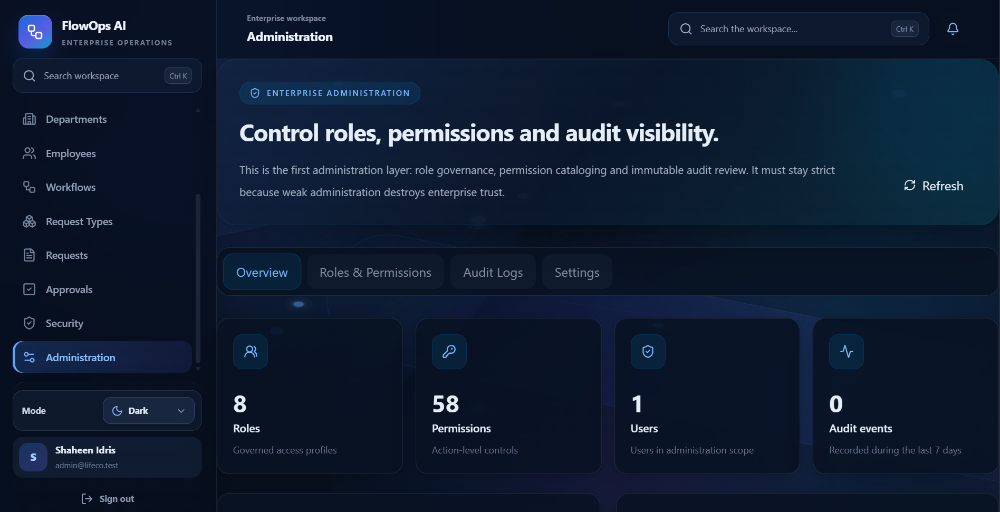
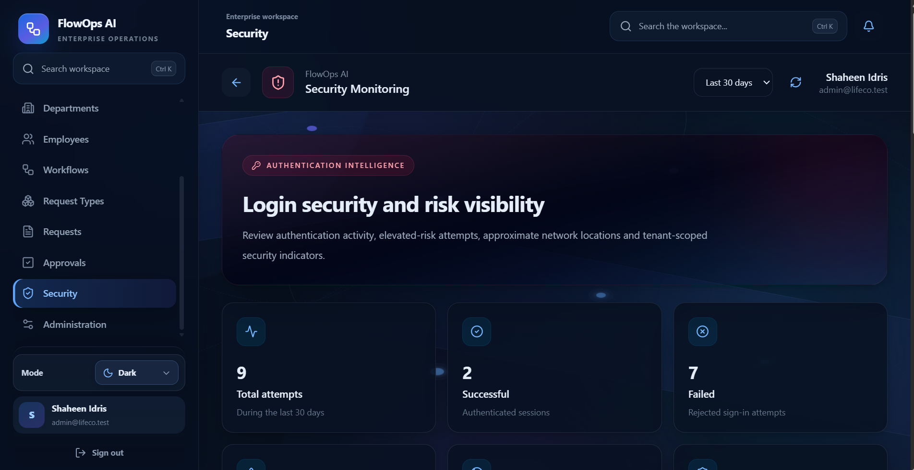
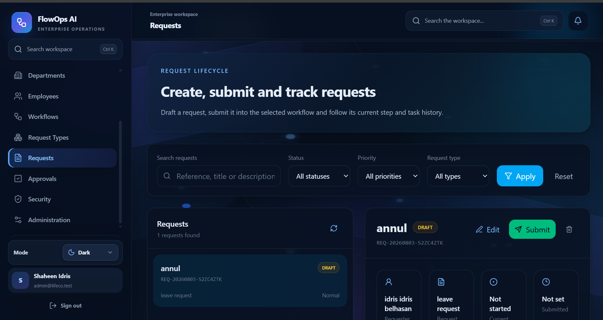

# FlowOps AI

**Enterprise Workflow / BPM / Operations Platform**

FlowOps AI is a full-stack enterprise workflow platform for managing internal company requests, approval workflows, notifications, analytics, security monitoring, role-based access control, and administration.

It was built as a production-quality portfolio project to demonstrate real business application engineering using **Laravel, React, TypeScript, PostgreSQL, Redis, Docker, and enterprise permission design**.

---

## Problem

Many organizations still manage internal approvals through email, spreadsheets, chat messages, and manual follow-up.

This creates several operational problems:

- Requests get lost or delayed.
- Approval responsibility is unclear.
- Managers cannot easily see pending work.
- Security and permissions are difficult to control.
- There is limited visibility into request history, failed logins, workflow status, and operational performance.

---

## Solution

FlowOps AI centralizes internal operations into one structured enterprise workspace.

The platform allows employees to create internal requests, routes those requests through active workflows, generates approval tasks, notifies the right users, tracks request status, exposes analytics, and gives administrators visibility over roles, permissions, security events, and audit activity.

---

## Preview

### Operations Dashboard


### Create Request Workflow


### Enterprise Administration



---

## Product Screens

### Security Monitoring



### Request Workspace



### Approval Inbox


---

## Core Features

- Authentication
- Departments management
- Employees management
- Request types
- Workflow builder
- Internal request creation
- Approval engine
- Approval inbox
- Approve / reject flow
- Notifications and notification bell
- SLA reminders and overdue escalation
- Analytics dashboard
- Workspace search
- Security monitoring
- Login attempt visibility
- Enterprise administration
- Roles and permissions
- Audit visibility
- Light and dark mode
- Docker production setup
- Health endpoint

---

## Technical Implementation

### Frontend

- **React + TypeScript** for a typed enterprise UI.
- **Vite** for fast development and production builds.
- **Tailwind CSS** for a polished design system.
- **React Router** for workspace navigation.
- **React Query** for API state, caching, loading states, and mutation handling.
- **Framer Motion** for smooth page transitions.
- **Lucide Icons** for consistent enterprise-style iconography.

### Backend

- **Laravel 12** REST API.
- **PostgreSQL** relational database.
- **Redis** for queues and operational background work.
- **Docker** for production-style local deployment.
- **Spatie Permission** for role-based access control.
- **JWT/Sanctum-style protected API access** depending on environment configuration.
- Queue and scheduler-ready architecture for notifications, SLA reminders, and escalation flows.

---

## Architecture Overview

```text
React + TypeScript Frontend
        ↓
Laravel REST API
        ↓
PostgreSQL Database
        ↓
Redis Queue / Scheduler
        ↓
Workflow automation, notifications, analytics and security visibility
```

---

## Main Workflow

```text
Employee
  ↓
Create Request
  ↓
Workflow Engine
  ↓
Approval Tasks
  ↓
Approval Inbox
  ↓
Approve / Reject
  ↓
Completed / Rejected
```

---

## Demo Video

A short 60–90 second demo video will be added after the final screen recording.

Suggested title:

```text
FlowOps AI — Enterprise Workflow Platform Demo
```

The video will demonstrate:

1. Dashboard and workspace navigation.
2. Department and employee management.
3. Internal request creation.
4. Approval inbox and approve/reject flow.
5. Notifications and security monitoring.
6. Administration, roles, permissions, and audit visibility.

---

## Local Setup

```powershell
git clone <your-repository-url>
cd FlowOps-AI
docker compose up -d --build
```

Health check:

```text
http://localhost:8080/api/health
```

---

## Verification

Run the portfolio verification script:

```powershell
powershell -NoProfile -ExecutionPolicy Bypass -File scripts\portfolio\verify-portfolio.ps1
```

---

## Engineering Value

FlowOps AI demonstrates:

- Full-stack product engineering
- Enterprise workflow modeling
- REST API design
- Permission-based access control
- Workflow state management
- Frontend state management
- Dockerized deployment
- Debugging and production-readiness discipline
- Professional documentation and presentation

---

## Roadmap

The following features are intentionally kept as future scope so the portfolio release stays focused:

- Advanced BPM
- AI assistant
- Reporting center
- Multi-workspace tenancy
- API tokens
- Advanced session management
- Feature flags
- Branding system

---

## Author

**Shaheen Idris**  
Software Engineer — Libya  
Laravel, React, TypeScript, PostgreSQL, Redis, Docker, enterprise systems, workflow automation.
